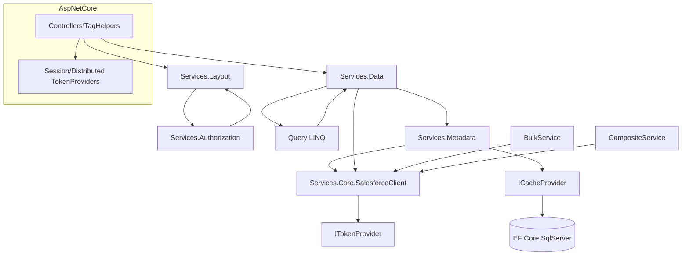
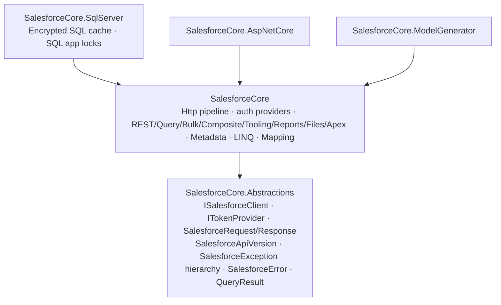

# SFC (SalesforceCore) Architecture Review: v1.3.0 → v2.0.0

Repo: `k4lp/SFC`. Baseline: `master` at v1.3.0 (commit `c69874d`). Review date: 25 Oct 2026.
Routine: **Phase A scan and map** (no code changes) → **Phase B self-review** → **Phase C implement** → **Phase D PR, merge, release**.

## 0. Direction from the owner (binding)
1. **No access gating in the library.** Object or field visibility rules, deny-by-default, dropping fields "the user can't write" and policy engines are Salesforce's job. The library passes the request through and surfaces Salesforce's own error. SFC-18 (object allow-list) is **dropped permanently**.
2. Protections against attackers **stay**: SOQL/SOSL escaping, ID path validation, the token host allow-list, XSS-safe file preview, encrypted, user-bound token cache, CSRF on state-changing endpoints, and ReDoS-safe regexes.
3. The library should be modular, reusable and dynamic: a proper ecosystem.

## 1. Method
* **File order.** Each `.cs` file was dated by its first commit (`git log --diff-filter=A`). **186 of 201 files come from the initial commit (2026-01-07)**, 9 from 2026-01-10 and 6 from 2026-10-25 (v1.1 to v1.3 tests). Review went oldest to newest, so in practice the whole original code base was reviewed first, core first (`Services/Core`, `Extensions`, `Models/Errors`, `Services/Data`, `Services/Metadata`, `Models/Data`, `Mapping`, `Query`), followed by the satellite modules (Authorization, Layout, Validation, Tracking, Schema, Caching, AspNetCore, ModelGenerator).
* **Dependency graph.** A grep-based scanner (`scan.py`, kept with this report) builds the namespace graph from `using SalesforceCore.*` edges, finds duplicate public type names, finds constructors with 6 or more dependencies, and counts `Task` members that take no `CancellationToken`. The graph is in `ns_graph.mmd` (46 namespaces, 166 edges).
* **Coverage.** coverlet.collector (XPlat Code Coverage) with Cobertura output, summarised per project.
* **Benchmark.** Azure SDK .NET design guidelines: options pattern, an HTTP pipeline built from handlers, `Response`/raw-response access, `IAsyncEnumerable` paging, a `RequestFailedException`-style error that carries the service error code, DI-first registration, `ILogger`, and cancellation everywhere.

## 2. Architecture map (v1.3.0)
### 2.1 Projects / packages
| Project | Role | Notes |
|---|---|---|
| `SalesforceCore` (≈42k LOC) | Everything: HTTP client, auth providers, REST/query/bulk/composite/tooling/reports/files/apex, schema, LINQ provider, mapper, validation, change tracking, layout/permission UI services, the visibility policy engine, FLS enforcement, memory/distributed/**SQL Server** caching, SQL app locks | One monolithic package. The core client pulls in **EF Core SqlServer** even when the consumer never uses the SQL cache. |
| `SalesforceCore.AspNetCore` | MVC controllers, tag helpers, view components, OIDC auth, session/distributed token providers, middleware | Depends on core |
| `SalesforceCore.ModelGenerator` | CLI that generates C# models from describe | **Re-declares** `GlobalDescribeResult`, `SObjectInfo`, `SObjectDescribe` instead of using the core models |

### 2.2 Layering (intended vs actual)
Intended: `Models` ← `Services.Core` (transport) ← feature services (`Data`, `Metadata`, `Query`, …) ← UI (`Layout`, `Authorization`) ← AspNetCore.
Actual: two namespace cycles, **`Services.Authorization ↔ Services.Layout`** and **`Query ↔ Services.Data`**. The transport layer (`SalesforceClient`) owns auth, refresh, URL building, error parsing, serialization and logging in a single class. There's no pipeline, so cross-cutting concerns can't be plugged in.

The full namespace graph is in `ns_graph.mmd`.

### 2.3 Public API surface
* `SalesforceCore`: **347 public types, only 43 interfaces**. `SalesforceCore.AspNetCore`: 43 public types, 0 interfaces. `ModelGenerator`: 9.
* Duplicate public type names: `BatchResult` ×2, `RecordAttributes` ×2, `FormMode` ×3, `FormSection` ×2, `FieldPermissionRequirement` ×2, `ServiceCollectionExtensions` ×2, `GlobalDescribeResult`/`SObjectInfo`/`SObjectDescribe` ×2 (generator).
* 37 `Task`-returning members take no `CancellationToken`.

### 2.4 DI registrations (`Extensions/ServiceCollectionExtensions.cs`)
* `AddSalesforceCore(IConfiguration | Action<SalesforceOptions> | ())` and `AddSalesforceCoreWithoutAuth`. They register about 30 scoped services, a typed `HttpClient` with the standard resilience handler, two named token clients, a hosted `TokenRefreshBackgroundService` (always), a singleton `SynchronizationService`, the visibility services, and the FLS service.
* Extension points: `ITokenProvider`, `ICacheProvider`, `IUserContextProvider`, `IVisibilityRequirementHandler`, `IDistributedLockProvider`, and `IBatchProcessor`. **Missing**: HTTP handlers or a pipeline, error mapping, the serializer, and the API-version policy.

## 3. Findings (Phase A)
Severity: **H** = wrong behaviour or a design blocker, **M** = significant quality or maintainability debt, **L** = cosmetic. **BC** = fixing it is a breaking change.

| ID | Sev | File:line | Problem | Target design | BC |
|---|---|---|---|---|---|
| ARC-01 | H | `Extensions/ServiceCollectionExtensions.cs:146-147, 186-231, 383` | Options are read **eagerly** from `new SalesforceOptions()` (+ `IConfiguration` only). With `AddSalesforceCore(o => …)` the user's `HttpTimeout`, `MaxRetries`, `RetryBaseDelay`, circuit-breaker settings, timeouts and `CacheProvider` are **silently ignored**. | Resolve `IOptions<SalesforceOptions>` lazily: `ConfigureHttpClient((sp,c)=>…)`, `AddResilienceHandler(... (builder, ctx) => …)` reading options at build time, and the cache provider picked by a factory at resolve time. | No (fixes the contract) |
| ARC-02 | H | `Extensions/ServiceCollectionExtensions.cs:158`, `Mapping/SalesforceMapper.cs:29-41` | `SalesforceMapper.Configure(...)` writes a **process-wide static**. With the `Action` overload it's always reset to `false`, and two hosts in one process overwrite each other. | Apply it from options at startup through `IPostConfigureOptions`, documented as process-wide. | No |
| ARC-03 | H | `Models/Data/CompositeModels.cs:390, 413, 435, 469` | `CompositeGraphBuilder` hard-codes `SalesforceConstants.DefaultApiVersion` (v60.0) in sub-request URLs and ignores the configured API version. Object names and IDs are interpolated into paths without validation. | The builder takes the API version from the client (`CompositeService.CreateGraphBuilder()`). Path segments are validated with the same `SecurityUtils` checks as `DataService`. | Constructor gains an overload |
| ARC-04 | H | `Services/Core/SalesforceClient.cs:557-614` | The error model is flat: every HTTP failure is thrown as a base `SalesforceException`. The nine subclasses (`NotFound`, `RateLimit`, `Validation`, `RecordLocked`, `DuplicateRule`, `Query`, …) are **never produced by the transport**, so `catch (SalesforceNotFoundException)` never fires. Subclass constructors drop `HttpStatusCode`, `RawResponse` and the error list. 429 ignores `Retry-After`. | One `SalesforceErrorMapper` maps (status, errorCode) to the typed exception. Every exception carries `HttpStatusCode`, `ErrorCode`, `Errors` (all Salesforce errors), `Fields`, `RawResponse` (truncated) and `RequestId`. | Yes (more specific types are thrown; all still derive from `SalesforceException`) |
| ARC-05 | M | `Services/Core/SalesforceClient.cs:59-183, 321-415, 509-550` | Two parallel send paths (a recursive `SendRequestAsync` plus `SendWithRefreshAsync`) and four copies of the "empty body → empty JsonObject" logic. Debug logging depends on an `EnableDebugLogging` flag instead of `ILogger` levels. | A single `SendAsync(SalesforceRequest) → SalesforceResponse` core path, with every verb as a thin wrapper. Logging and limits handling move into pipeline handlers. | No |
| ARC-06 | M | `Services/Core/SalesforceClient.cs:47-49` | The client **mutates the injected `HttpClient`** (Timeout, Accept). That duplicates the registration and throws if the client was already used. | Configure it in the registration only. | No |
| ARC-07 | M | `Services/Core/ISalesforceClient.cs` | There's no raw request/response API: callers can't read headers (`Sforce-Limit-Info`, `ETag`, `Location`), status, or send custom content without a new method per case (`PutRawAsync`, `GetRawAsync`, `GetBytesAsync`…). | `Task<SalesforceResponse> SendAsync(SalesforceRequest, CancellationToken)` as the universal extension point (Azure `Response` analogue). | Additive |
| ARC-08 | M | (no file) | There's no HTTP pipeline extension point, so API-usage tracking, correlation IDs, tracing and logging can't be plugged in. | Named client `SalesforceHttpClientNames.Api`; `AddSalesforceHttpHandler<T>()`. Built-in `SalesforceApiUsageHandler` (parses `Sforce-Limit-Info` into `ISalesforceApiUsage`) and `SalesforceLoggingHandler` (method, path, status and elapsed time, never query strings or tokens). | Additive |
| ARC-09 | M | `SalesforceConstants.cs:24`, `ModelGenerator/Program.cs:38`, `SalesforceOptions.cs:49` | The API version is a raw string with two different defaults (v60.0 core, v62.0 generator) and no validation; "62.0" without the `v` produces broken URLs. | `SalesforceApiVersion` value type (parse/normalise/compare). A single default constant, used by the generator too. `ApiVersion` is normalised and validated in `PostConfigure`/`Validate`. | Default changes to v62.0 |
| ARC-10 | M | `Services/Data/DataService.cs:73-93` | `QueryNextAsync` strips `/services/data/{configured version}` only when the version matches exactly. Any other version prefix produces a double-versioned URL. | Pass `/services/...` paths through untouched (the client already supports absolute service paths). | No |
| ARC-11 | M | `Models/Data/QueryResult.cs:140-185` vs `Services/Data/IDataService.cs:398` | Two public `BatchResult` classes. The `Models.Data` one (+ `BatchItemResult`) is **dead code**. The same goes for `RecordAttributes` ×2 and `FormMode` ×3. | Delete the dead copies and keep one canonical type. | Yes (dead types removed) |
| ARC-12 | M | `Extensions/ServiceCollectionExtensions.cs:266-267` | `IApexService` is registered as a typed `HttpClient` + resilience handler, but `ApexService` never takes an `HttpClient`. That leaves a wasted handler pipeline, double retries (the API client already retries), and transient lifetime. | `AddScoped<IApexService, ApexService>()`. | No |
| ARC-13 | M | `Extensions/ServiceCollectionExtensions.cs:285` | `TokenRefreshBackgroundService` is **always** registered, even for user-context (OIDC) apps, and creates a scope every minute. | Opt-in via `SalesforceOptions.EnableBackgroundTokenRefresh` (default true only when a server-to-server provider is auto-registered). | Minor |
| ARC-14 | M | `SalesforceCore.csproj` | The core package hard-depends on `Microsoft.EntityFrameworkCore.SqlServer` for an optional cache and lock provider. | Move `Services/Caching/SqlServer` + `Infrastructure/Locking/SqlServer` into a new `SalesforceCore.SqlServer` package (same namespaces). | Yes (add a package reference) |
| ARC-15 | M | whole repo | No abstractions package. Third-party add-ons (auth providers, handlers, mocks) must reference the whole monolith. | `SalesforceCore.Abstractions`: `ISalesforceClient`, `ITokenProvider`, `SalesforceRequest/Response`, `SalesforceApiVersion`, the exception hierarchy, `SalesforceError`, `QueryResult`. Same namespaces, so it isn't source-breaking. | Binary only |
| ARC-16 | M | `Services.Authorization ↔ Services.Layout`, `Query ↔ Services.Data` | Namespace cycles. | Break the Authorization→Layout edge by removing the visibility engine (GATE-03); the Query↔Data cycle is documented and deferred (LINQ provider rewrite). | – |
| ARC-17 | M | `Query/SalesforceQueryable.cs` (2,637 lines, 14 types), `Services/Data/DataService.cs` (1,521), `Services/Layout/LayoutDescriptorService.cs` (1,546), `Services/Query/SoqlBuilder.cs` (1,416) | God classes. `DataService` mixes query, CRUD, lookups, files, batch/bulk routing, recent items and user info. | `DataService` loses the FLS/filter logic (about 250 lines). The split of `DataService` into `IRecordService`/`IQueryService`/`IFileService` and the queryable file split are deferred to 2.1 to avoid a half-done refactor (§7). | – |
| ARC-18 | L | `Query/SalesforceQueryable.cs:291`, `EncryptedSqlServerCache.cs:137,185,233,304` | Sync-over-async. The `IQueryProvider.Execute` and `IDistributedCache` sync members are forced by the framework interfaces. | Documented. Async paths are preferred (`ToListAsync`, `GetAsync`). | – |
| ARC-19 | L | 37 members (`SessionTokenProvider`, `ChannelBatchProcessor`, `ValidationRules`, …) | `Task` members with no `CancellationToken`. | Add CT to public interfaces touched in 2.0 (token provider and core), defer the rest. | Partly |
| ARC-20 | L | `ModelGenerator/ModelGenerator.cs` | Duplicate describe DTOs. | Reuse the core models (deferred, CLI-only). | – |
| GATE-01 | H (owner direction) | `Services/Data/DataService.cs:1195-1398`, `SalesforceOptions.cs:240-252` | The library **silently drops or rejects fields** on create, update, upsert and batch (`EnforceFieldLevelSecurity`, `FlsEnforcementMode` Silent/Strict, `FlsException`), and drops calculated, auto-number and "non-createable" fields even with FLS off. Salesforce already enforces FLS and returns `INVALID_FIELD_FOR_INSERT_UPDATE`. | **Pass-through**: the payload goes to Salesforce as given, and Salesforce's error is surfaced as a typed `SalesforceException`. Remove the options, `FlsEnforcementMode` and `FlsException`. Reads still validate field **names** against describe (an injection guard, not gating). | Yes |
| GATE-02 | H (owner direction) | `Security/FieldLevelSecurity.cs` (whole file) | `IFieldLevelSecurityService` filters, strips and validates payloads client-side (`StripInaccessibleFields`, `EnforceFlsAttribute`). | Remove it. Describe flags stay available on `SObjectField` for UI rendering. | Yes |
| GATE-03 | H (owner direction) | `Services/Authorization/VisibilityService.cs`, `Handlers/*`, `VisibilityOptions.cs`, `AspNetCore/TagHelpers/VisibilityTagHelper.cs`, `SalesforceController.cs:75-81,178-182,241-245,292-297,359-364`, `LayoutDescriptorService.cs:510-513,786-795` | An app-side role/policy engine (`VisibilityPolicy`) **blocks** objects, records, related lists and nav items (SFC-02 extended it to Details). | Remove the engine and the `VisibilityPolicy` config. Controllers pass through to Salesforce. | Yes |
| GATE-04 | H (owner direction) | `SalesforceController.cs:256-258, 302, 375, 435`, `AspNetCore/Attributes/SalesforceAuthorizeAttribute.cs`, `Services/Authorization/PermissionGuard.cs` | Controllers return `Forbid()`/404 when describe says *not createable/updateable*. `SalesforceAuthorizeAttribute` and `PermissionGuard` block requests on client-side permission checks. | Remove the pre-checks, the attribute and the guard. Salesforce's 403 `INSUFFICIENT_ACCESS` is surfaced as `SalesforcePermissionException`, which the middleware maps to 403. | Yes |
| GATE-05 | – (keep) | `Services/Metadata/SchemaService.cs` (SFC-07 per-user describe cache) | Reviewed against direction 1. This is **not** gating: it caches *Salesforce's* describe answer per user, so user B is never served user A's metadata. Removing it would be a data-disclosure bug. | **Keep** (correctness and caching). | – |
| TST-01 | H | `tests/*` (all 2026-01-07 files) | Mock-heavy old tests (`Mock<ISalesforceClient>` with string-matched endpoints). They test the mocks, not HTTP behaviour, and break on any URL refactor. | A shared **TestKit**: `FakeSalesforceServer` (a routing `HttpMessageHandler` with a request journal), `TestTokenProvider`, `SalesforceTestHost` (real DI + fake server), and JSON builders (`Records`, `Describe`, `Errors`). | – |
| TST-02 | H | `ApexServiceTests.cs` | 1 test, **0 assertions**, swallows `JsonReaderException`, and uses Newtonsoft, which isn't a dependency of the library. | Rewrite against the fake server. | – |
| TST-03 | M | `AuthenticationOptionsTests.cs`, `LayoutDescriptorServiceTests.cs`, `ReportServiceTests.cs`, `ToolingServiceTests.cs`, `SearchServiceTests.cs` | Weak assertions (`NotBeNull`/`NotThrow`) on about 30% of asserts. | Strengthen or replace. | – |
| TST-04 | H | coverage | **0%** on the core DI registration (`ServiceCollectionExtensions`), `BulkService`, `LookupService`, `TypedDataService`, `FileService` and `FieldHistoryService`. | Composition-root tests via `SalesforceTestHost`, plus end-to-end tests for bulk, lookup, files and typed data. | – |
| TST-05 | M | `SalesforceClientEndToEndTests.cs:20-55` | The good fake (from v1.1) is a private nested class, copied again in `ScanFixesV130Tests`, `SalesforceClientRobustnessTests` and `SalesforceClientPatchTests`. | Promote it to the TestKit and reuse it everywhere. | – |

### 3.1 Coverage baseline (v1.3.0, 698 tests)
| Project | Line | Branch |
|---|---|---|
| **Total** | **35.6%** | **27.9%** |
| SalesforceCore | 40.3% | 33.9% |
| SalesforceCore.AspNetCore | 19.8% | 11.2% |
| SalesforceCore.ModelGenerator | 7.3% | 14.9% |

Biggest uncovered files: SalesforceModelFormTagHelper (0/397), EncryptedSqlServerCache (57/443), BulkService (0/357), FieldValidator (18/347), SchemaDiff (0/328), ModelGenerator (42/350), ValidationRules (5/274), FieldDependencyGraph (0/232), LookupService (0/229), core ServiceCollectionExtensions (0/203).
Test speed is fine (about 0.5 s for the whole suite) with no flakiness seen across 3 runs, so slow and flaky tests aren't a problem.

### 3.2 Comparison with Azure SDK guidelines (v1.3.0)
| Guideline | v1.3.0 | 2.0 target |
|---|---|---|
| Options pattern | Present, but ignored for HTTP and cache with the `Action` overload (ARC-01) | Honoured everywhere, validated, normalised |
| HTTP pipeline / handlers | Fixed in code (ARC-08) | Named client + pluggable `DelegatingHandler`s; built-in usage and logging handlers |
| Response type | None (ARC-07) | `SalesforceResponse` (status, headers, body, request id) |
| Paging with `IAsyncEnumerable` | `QueryAllAsyncEnumerable` exists | Kept; `QueryNextAsync` URL bug fixed (ARC-10) |
| `RequestFailedException`-style errors | Flat (ARC-04) | Typed hierarchy with Salesforce error codes |
| DI-friendly | Mostly; with static mapper state (ARC-02) | Options-driven and honoured for both overloads; the mapper switch is still process-wide (documented, deferred) |
| `ILogger` | Flag-gated debug logs | Logging handler at Debug/Information, redacted |
| Cancellation everywhere | 37 gaps (ARC-19) | Core is complete; the rest is listed |

## 4. Phase B: self-review
Each finding was re-checked against the code before implementation:
* **ARC-01 confirmed** by reading `RegisterCoreServices`. The `Action` overload passes `configuration: null`, so `options` is `new SalesforceOptions()`. A regression test now proves `HttpTimeout` and `MaxRetries` are honoured.
* **ARC-03 confirmed**. All four builder methods use the constant, never the client's version.
* **ARC-04 confirmed**. `grep "new Salesforce(NotFound|RateLimit|…)Exception"` in `Services/Core` returns only the base type and the auth type.
* **ARC-11 confirmed dead**. No reference to `Models.Data.BatchResult` or `BatchItemResult` in `src`/`tests`.
* **ARC-12 confirmed**. `ApexService(ISalesforceClient, ILogger)` has no HttpClient parameter.
* **Dropped as weak or false positives:** (a) "static `ConcurrentDictionary` caches in `TypeDescriptor`/`SalesforceMapper` are bad". Per-`Type` reflection caches are immutable facts about types and are correct as statics. (b) "`SynchronizationService` stripe collisions". 1,024 stripes is fine. (c) "`IQueryProvider.Execute` sync-over-async must be removed". The framework requires it. (d) "Hard-coded `ContentVersion`/`ContentDocument` in `FileService`". These are *the* Salesforce Files API objects, not app objects, so it's not a dynamism defect. (e) "Hard-coded `User` in the auth attribute". It disappears with GATE-04 anyway.
* **GATE-05 reversed** from "remove" to "keep" (reason above).
* **Target design sanity check.** A full split of every feature into its own NuGet package (REST/Query/Bulk/Metadata/Auth) was considered and **rejected for 2.0**. The feature services share `SchemaService`, `SalesforceMapper` and the LINQ provider, so splitting them now would mean either circular package references or a massive move with a high risk of shipping something half-broken. 2.0 ships a **real abstractions package**, a **separate SqlServer package**, a pipeline, an error model and pass-through semantics. The rest gets clear namespaces and is scheduled (see §7).

## 5. Target architecture (2.0)

HTTP pipeline (named client `SalesforceCore.Api`):
`SalesforceClient → StandardResilienceHandler (total timeout, retry 5xx/408/429 with Retry-After, circuit breaker, attempt timeout) → SalesforceLoggingHandler → SalesforceApiUsageHandler → [user handlers…] → primary handler`.
Auth (bearer + one refresh on 401 + instance-URL allow-list) stays in the client because it needs the token provider's scoped state.

## 6. Migration plan (summary; full guide in `MIGRATION.md`)
1. Add `SalesforceCore.SqlServer` if you use the encrypted SQL cache or SQL locks.
2. Remove `EnforceFieldLevelSecurity`, `FlsEnforcementMode`, `VisibilityPolicy` and the `Visibility` config section. Catch `SalesforceException` (or the typed subclasses) instead of `FlsException`.
3. Replace `[SalesforceAuthorize]`, `IPermissionGuard` and `<sf-visible>` with your app's own authorization; Salesforce enforces data access.
4. If you caught base `SalesforceException`, nothing changes. You can now catch `SalesforceNotFoundException`, `SalesforceRateLimitException` and the other typed exceptions.
5. The default API version changes from `v60.0` to `v62.0`. To keep the old one, set `ApiVersion`.

## 7. Results (2.0.0 as shipped)

### 7.1 Late findings discovered while implementing
| ID | Sev | Problem (v1.3.0) | Fix in 2.0 |
|---|---|---|---|
| ARC-21 | **H** | Default `CircuitBreakerSamplingDuration` (30s) = `PerAttemptTimeout` (30s) **fails Polly validation**. Proven with a probe test against `master`: `AddSalesforceCore(o => {})` → resolving `ISalesforceClient` throws `OptionsValidationException`. No test in 1.x ever built the real pipeline. | Default sampling 60s; clamped to 2 × attempt timeout; regression tests for 30/30 and 10/45. |
| ARC-22 | H | `HttpTimeout` reset to infinite by the standard resilience handler. | Re-applied after the handler; test asserts 17s. |
| ARC-23 | **H** | Bulk 2.0 `CloseJobAsync`/`AbortJobAsync`/query abort used `POST`; Salesforce requires `PATCH`, so ingest jobs could never be closed. | `PATCH`; end-to-end lifecycle test. |
| ARC-24 | M | Bulk job ids interpolated into paths unvalidated; `locator` not URL-escaped. | `JobPath` validates 15/18-char ids; locator escaped. |
| ARC-25 | M | Apex REST paths accepted `..`, `//`, absolute URLs; `QueryNextAsync` silently shortened `//host/services/...`. | Rejected with `ArgumentException` before any request. |

### 7.2 Numbers
| Metric | v1.3.0 | 2.0.0 |
|---|---|---|
| Tests | 698 | 781 (+83 new, gating tests removed, old suites adapted) |
| Line coverage (total) | 35.6% | 37.5% |
| Branch coverage (total) | 27.9% | 30.1% |
| SalesforceCore line / branch | 40.3% / 33.9% | 43.9% / 36.1% |
| SalesforceCore.Abstractions | – | 77.5% / 80.4% |
| SalesforceCore.AspNetCore | 19.8% / 11.2% | 20.8% / 11.3% |
| SalesforceCore.SqlServer | (in core) | 5.6% / 4.4% |
| Build warnings (Release, analyzers on) | 0 | 0 |
| Vulnerable packages (incl. transitive) | 0 | 0 |
| Packages | 3 | 5 (+ Abstractions, SqlServer) |
| Source diff | – | 66 src files, +1,176 / −3,183 lines |

Total coverage moves modestly because the denominator is dominated by large untouched files (LINQ provider, layout, tag helpers, SQL cache); the transport, DI root, bulk, apex and error paths that were at 0% are now covered end-to-end.

### 7.3 Status of findings
* **Done:** ARC-01, 03, 04, 05, 06, 07, 08, 09, 10, 11, 12, 13 (auto only for JWT/ClientCredentials configs, plus explicit `AddSalesforceBackgroundTokenRefresh`), 14, 15, 16 (Authorization↔Layout), 21–25; GATE-01–04; GATE-05 kept; TST-01 (TestKit), TST-04 (DI root, Bulk, Apex now covered), TST-05.
* **Partial:** ARC-02 (option honoured, still process-wide static), ARC-19 (core done), TST-02 (Apex covered by new end-to-end tests; the old Newtonsoft test remains), TST-03.
* **Deferred:** per-feature package split; `DataService` / `SalesforceQueryable` god-class split (ARC-17); Query↔Data namespace cycle; remaining CancellationToken gaps; ModelGenerator duplicate DTOs (ARC-20); sync-over-async forced by framework interfaces (ARC-18); coverage of LookupService, FileService, TypedDataService, SqlServer cache, tag helpers.
